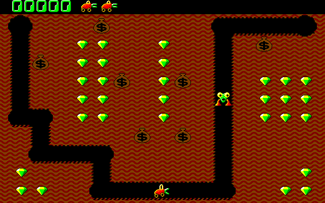

# Digger Remastered — Java port

A faithful Java/Swing port of **Digger Remastered** (Copyright (c) Andrew Jenner
1998-2004, GPL v2; original game Copyright (c) 1983 Windmill Software). The C
sources live in `../digger-src`; this is a line-by-line translation of the
game logic that loads the **original binary sprite/font assets** (`vga.spr`,
`vgatext.spr`) at runtime.



## Build & run

Requires a JDK 17+ to compile/run. Gradle 9 itself needs JDK 17+; this repo's
`gradle.properties` points Gradle at a local JDK 22 — edit that path if your JDK
is elsewhere.

```sh
./gradlew run            # build and launch the game
./gradlew build          # produce build/libs/digger-java.jar
java -jar build/libs/digger-java.jar
```

## Distributions

Two packaging options:

**Without a bundled JDK** (small; the user must have Java 17+ installed) — the
standard `application`-plugin distribution:

```sh
./gradlew distZip        # build/distributions/digger-java.zip  (~90 KB)
./gradlew installDist    # build/install/digger-java/  (run bin/digger-java[.bat])
```

**With a bundled JDK** (self-contained; no Java needed to run) — a `jpackage`
app image. Requires building on JDK 14+ (this repo already runs Gradle on
JDK 22); the app-image type needs no extra tooling (unlike `.msi`/`.exe`
installers, which need WiX):

```sh
./gradlew jpackageImage  # build/jpackage/Digger/Digger.exe  (~150 MB, bundled runtime)
./gradlew jpackageZip    # build/distributions/Digger-app-image.zip
```

On Windows this yields `Digger.exe`; on macOS/Linux jpackage produces the
platform's native app image instead.

## Android

`android/` is an Android app that reuses the shared game logic in
`src/main/java` (platform-neutral) and the original sprite files; the Swing
launcher lives in `src/desktop/java`. The module is only included when an
Android SDK is found (`local.properties` `sdk.dir`, or `ANDROID_HOME`).

```sh
./gradlew :android:assembleRelease   # android/build/outputs/apk/release/android-release.apk
./gradlew :android:installDebug      # install a debug build on a connected device
```

Release signing reads `android/keystore.properties` (`storeFile`,
`storePassword`, `keyAlias`, `keyPassword`); keep it and the `.jks` out of
version control. Without it the release APK is built unsigned.

Touch controls: D-pad (bottom-left), FIRE (bottom-right), buttons for pause,
1P/2P, music and sound (top-right); tap the playfield to start / continue.
Back = F10 (end game / quit). Keyboards and gamepads (D-pad/stick, A/X = fire,
Start = Enter) work too; the on-screen keyboard opens for high-score initials.

## Run

Command-line options are passed through, matching the original where
implemented: `./gradlew run --args="/I:3 /2"` (start on level 3, two-player
simultaneous). Supported: `/I:level`, `/S:speed` (or a bare number),
`/G[:time]` gauntlet, `/2` two-player, `/Q` quiet, `/M` no music, `/U` unlimited
lives, `/V` vsync timing, `/L:file` level file, `/R:file` record, `/P:file`
playback.

## Controls

| Action            | Key                         |
|-------------------|-----------------------------|
| Move (Player 1)   | Arrow keys                  |
| Fire (Player 1)   | F1                          |
| Move (Player 2)   | W / A / S / D               |
| Fire (Player 2)   | Ctrl                        |
| Start game        | Any key (e.g. Enter)        |
| Toggle 1/2 players| Esc or N (at the title)     |
| Pause             | Space                       |
| Cheat (void DRF)  | T                           |
| Faster / slower   | + / -                       |
| Music / sound     | F7 / F9                     |
| Save recording    | F8                          |
| Quit              | F10 or close the window     |

## Architecture

Each C module maps to one Java class (all logic is `static`, mirroring the C
globals/functions so the translation stays 1:1):

| C source        | Java class   | Responsibility |
|-----------------|--------------|----------------|
| def.h           | `Def`        | constants, sprite indices, directions |
| main.c          | `Main`       | program shell, game loop, level data, RNG |
| digger.c        | `Dig`        | diggers, fireballs, emeralds, bonus mode |
| monster.c       | `Mon`        | Nobbins / Hobbins AI |
| bags.c          | `Bag`        | gold and money bags |
| sprite.c        | `Spr`        | sprite engine + bounding-box collisions |
| drawing.c       | `Draw`       | field, text, high-level draw routines |
| scores.c        | `Score`      | scoring + high-score table (DIGGER.SCO) |
| input.c         | `Inp`        | keyboard handling |
| sound.c         | `Snd`        | note state machines + square-wave synth |
| record.c        | `Rec`        | DRF record / playback |
| ini.c           | `IniFile`    | DIGGER.INI settings |
| mkg.c / vga.spr | `Assets`     | runtime sprite/font/palette decoding |
| win_vid.c       | `Vid`        | 640x400 indexed framebuffer + blitter |
| dospc.asm/win_sys.c | `Hw`     | timing + keyboard platform layer |
| (Swing window)  | `DiggerApp`  | JFrame, panel, key events, entry point |

### How rendering works

Like the original Windows build, the screen is a **640x400 8-bit indexed back
buffer** in which the logical 320x200 game coordinates are doubled. `Assets`
decodes the 32x32, 1-byte-per-pixel cells of `vga.spr` (a byte of `0xFF` is
transparent; the low nibble is the colour 0-15) and reproduces the `vgatable`
sprite-index mapping from `mkg.c`. The 16-colour palettes (`gpal`/`ginten`
select one of four) come straight from `win_vid.c`. Fireball-versus-dirt
collisions read back rendered pixels via `ggetpix`, exactly as the original did.

### Faithfulness notes

* **Game logic** (digger/monster/bag/score/field/collision) is a direct
  translation, preserving update order and the 32-bit RNG so behaviour matches.
* **Graphics** use the original sprite/font data, including the tunnel-edge
  "blob" sprites. Those overflow a 32x32 cell in the original's layout (stored
  with the "tall"/"wide" packing from `mkg.c`); `Vid.gputim` reconstructs that
  packing so the carved tunnels keep their original rounded edges.
* **Sound** runs the original note/jingle state machines from `sound.c` and
  feeds a single square-wave voice (effects take priority over music, as the one
  PC speaker did). Sound silently disables itself if no audio line is available.
* **Title screen**: the decorative title bitmap is not loaded; the menu (the
  `DIGGER` banner, high-score table and the walking-character demo) draws on a
  black background.
* **DRF** recording works (press F8 to save); playback is available via `/P`.
* CGA mode and the joystick are not ported (VGA + keyboard only).

The two `-Ddigger.*` system properties (`shot`, `shotdelay`, `autostart`) are
debug hooks used to capture screenshots headlessly; they have no effect in
normal play.
