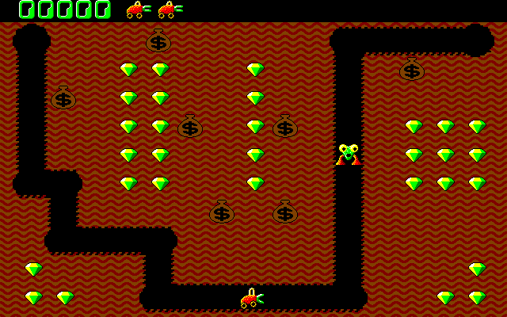

# Digger Remastered — portage Java

*[English version](README.md)*

Un portage Java/Swing fidèle de **Digger Remastered** (Copyright (c) Andrew Jenner
1998-2004, GPL v2 ; jeu original Copyright (c) 1983 Windmill Software). Les sources
C se trouvent dans `../digger-src` ; il s'agit d'une traduction ligne à ligne de la
logique du jeu, qui charge à l'exécution les **fichiers binaires originaux de sprites
et de police** (`vga.spr`, `vgatext.spr`).



## Compilation et exécution

Un JDK 17+ est nécessaire pour compiler et exécuter. Gradle 9 lui-même exige un JDK 17+ ;
le fichier `gradle.properties` de ce dépôt indique à Gradle un JDK 22 local — modifiez
ce chemin si votre JDK se trouve ailleurs.

```sh
./gradlew run            # compile et lance le jeu
./gradlew build          # produit build/libs/digger-java.jar
java -jar build/libs/digger-java.jar
```

## Distributions

Deux options de packaging :

**Sans JDK embarqué** (léger ; l'utilisateur doit avoir Java 17+ installé) — la
distribution standard du plugin `application` :

```sh
./gradlew distZip        # build/distributions/digger-java.zip  (~90 Ko)
./gradlew installDist    # build/install/digger-java/  (lancer bin/digger-java[.bat])
```

**Avec JDK embarqué** (autonome ; aucun Java requis pour l'exécuter) — une image
d'application `jpackage`. La compilation doit se faire sur un JDK 14+ (ce dépôt
exécute déjà Gradle sur un JDK 22) ; le type app-image ne nécessite aucun outil
supplémentaire (contrairement aux installeurs `.msi`/`.exe`, qui nécessitent WiX) :

```sh
./gradlew jpackageImage  # build/jpackage/Digger/Digger.exe  (~150 Mo, runtime embarqué)
./gradlew jpackageZip    # build/distributions/Digger-app-image.zip
```

Sous Windows, on obtient `Digger.exe` ; sous macOS/Linux, jpackage produit à la place
l'image d'application native de la plateforme.

## Android

`android/` est une application Android qui réutilise la logique de jeu partagée de
`src/main/java` (indépendante de la plateforme) et les fichiers de sprites originaux ;
le lanceur Swing se trouve dans `src/desktop/java`. Le module n'est inclus que si un
SDK Android est trouvé (`sdk.dir` dans `local.properties`, ou `ANDROID_HOME`).

```sh
./gradlew :android:assembleRelease   # android/build/outputs/apk/release/android-release.apk
./gradlew :android:installDebug      # installe une build de débogage sur un appareil connecté
```

La signature de la version release lit `android/keystore.properties` (`storeFile`,
`storePassword`, `keyAlias`, `keyPassword`) ; gardez ce fichier et le `.jks` hors du
contrôle de version. Sans lui, l'APK release est produit non signé.

Commandes tactiles : croix directionnelle (en bas à gauche), FIRE (en bas à droite),
boutons pour la pause, 1P/2P, la musique et le son (en haut à droite) ; touchez l'aire
de jeu pour commencer / continuer. Retour = F10 (fin de partie / quitter). Claviers et
manettes (croix/stick, A/X = tir, Start = Entrée) fonctionnent aussi ; le clavier
virtuel s'ouvre pour saisir les initiales du tableau des meilleurs scores.

## Exécution

Les options de ligne de commande sont transmises telles quelles, avec le même
comportement que l'original lorsqu'elles sont implémentées : `./gradlew run --args="/I:3 /2"`
(début au niveau 3, deux joueurs simultanés). Options prises en charge : `/I:level`,
`/S:speed` (ou un nombre seul), `/G[:time]` mode gauntlet, `/2` deux joueurs, `/Q`
silencieux, `/M` sans musique, `/U` vies illimitées, `/V` synchronisation vsync,
`/L:file` fichier de niveaux, `/R:file` enregistrement, `/P:file` relecture.

## Commandes

| Action                    | Touche                            |
|---------------------------|-----------------------------------|
| Déplacement (joueur 1)    | Flèches de direction              |
| Tir (joueur 1)            | F1                                |
| Déplacement (joueur 2)    | W / A / S / D                     |
| Tir (joueur 2)            | Ctrl                              |
| Lancer la partie          | N'importe quelle touche (p. ex. Entrée) |
| Basculer 1/2 joueurs      | Échap ou N (à l'écran titre)      |
| Pause                     | Espace                            |
| Triche (invalide le DRF)  | T                                 |
| Plus rapide / plus lent   | + / -                             |
| Musique / son             | F7 / F9                           |
| Sauvegarder l'enregistrement | F8                             |
| Quitter                   | F10 ou fermer la fenêtre          |

## Architecture

Chaque module C correspond à une classe Java (toute la logique est `static`, à l'image
des variables globales et fonctions C, pour que la traduction reste 1:1) :

| Source C        | Classe Java  | Rôle |
|-----------------|--------------|------|
| def.h           | `Def`        | constantes, indices de sprites, directions |
| main.c          | `Main`       | coquille du programme, boucle de jeu, données des niveaux, générateur aléatoire |
| digger.c        | `Dig`        | diggers, boules de feu, émeraudes, mode bonus |
| monster.c       | `Mon`        | IA des Nobbins / Hobbins |
| bags.c          | `Bag`        | or et sacs d'argent |
| sprite.c        | `Spr`        | moteur de sprites + collisions par boîtes englobantes |
| drawing.c       | `Draw`       | terrain, texte, routines de dessin de haut niveau |
| scores.c        | `Score`      | score + tableau des meilleurs scores (DIGGER.SCO) |
| input.c         | `Inp`        | gestion du clavier |
| sound.c         | `Snd`        | machines à états des notes + synthé en signal carré |
| record.c        | `Rec`        | enregistrement / relecture DRF |
| ini.c           | `IniFile`    | réglages DIGGER.INI |
| mkg.c / vga.spr | `Assets`     | décodage à l'exécution des sprites, de la police et de la palette |
| win_vid.c       | `Vid`        | framebuffer indexé 640x400 + blitter |
| dospc.asm/win_sys.c | `Hw`     | couche plateforme pour la temporisation et le clavier |
| (fenêtre Swing) | `DiggerApp`  | JFrame, panneau, événements clavier, point d'entrée |

### Fonctionnement du rendu

Comme dans la version Windows originale, l'écran est un **tampon d'arrière-plan indexé
8 bits de 640x400** dans lequel les coordonnées logiques du jeu en 320x200 sont doublées.
`Assets` décode les cellules 32x32 à 1 octet par pixel de `vga.spr` (un octet `0xFF` est
transparent ; le quartet de poids faible est la couleur 0-15) et reproduit la
correspondance d'indices de sprites `vgatable` de `mkg.c`. Les palettes de 16 couleurs
(`gpal`/`ginten` en sélectionnent une parmi quatre) proviennent directement de
`win_vid.c`. Les collisions entre boules de feu et terre relisent les pixels rendus via
`ggetpix`, exactement comme le faisait l'original.

### Notes sur la fidélité

* La **logique de jeu** (digger/monstres/sacs/score/terrain/collisions) est une
  traduction directe, qui conserve l'ordre des mises à jour et le générateur aléatoire
  32 bits afin que le comportement soit identique.
* Les **graphismes** utilisent les données originales de sprites et de police, y compris
  les sprites « blob » des bords de tunnels. Ceux-ci débordent d'une cellule 32x32 dans
  la disposition de l'original (stockés avec l'empaquetage « tall »/« wide » de `mkg.c`) ;
  `Vid.gputim` reconstitue cet empaquetage pour que les tunnels creusés gardent leurs
  bords arrondis d'origine.
* Le **son** exécute les machines à états originales des notes et jingles de `sound.c`
  et alimente une seule voix en signal carré (les effets sont prioritaires sur la
  musique, comme avec l'unique haut-parleur du PC). Le son se désactive silencieusement
  si aucune ligne audio n'est disponible.
* **Écran titre** : l'image décorative du titre n'est pas chargée ; le menu (la bannière
  `DIGGER`, le tableau des meilleurs scores et la démo des personnages qui marchent)
  s'affiche sur un fond noir.
* L'enregistrement **DRF** fonctionne (appuyez sur F8 pour sauvegarder) ; la relecture
  est disponible via `/P`.
* Le mode CGA et le joystick ne sont pas portés (VGA + clavier uniquement).

Les deux propriétés système `-Ddigger.*` (`shot`, `shotdelay`, `autostart`) sont des
points d'accroche de débogage servant à capturer des captures d'écran sans affichage ;
elles n'ont aucun effet en jeu normal.

## Mentions légales et données du jeu

### Implémentation indépendante du moteur

Ce projet est une réimplémentation indépendante du moteur de *Digger*, conçue pour reproduire le comportement du jeu d'origine sur les plateformes modernes.

Le moteur a été développé à partir du code source d'origine de *Digger Remastered* (C, Copyright (c) Andrew Jenner 1998-2004, GPL v2), par analyse technique et tests de compatibilité. Ce code source n'est pas inclus dans ce dépôt.

### Fichiers du jeu d'origine

Le portage charge les fichiers de sprites et de police de *Digger Remastered* (`vga.spr`, `vgatext.spr`), distribués avec ses sources sous GPL v2 ; aucun autre fichier du jeu d'origine n'est nécessaire.

Eloane Studio n'héberge, ne distribue ni ne fournit de copies non autorisées de données de jeu protégées par le droit d'auteur.

### Droits d'auteur et marques

Les noms, marques, graphismes, musiques et autres éléments propriétaires de *Digger* restent la propriété de leurs titulaires respectifs (Windmill Software, Andrew Jenner).

Ce projet est une implémentation indépendante et non officielle ; il n'est ni affilié, ni approuvé, ni soutenu par les développeurs ou les éditeurs du jeu d'origine.

### Préservation

Ce projet a pour but de préserver le comportement technique et l'expérience de jeu des jeux vidéo classiques, tout en les rendant accessibles sur les systèmes modernes.

Le moteur est fourni à des fins de compatibilité, de préservation et d'éducation.

### Crédits

Jeu d'origine : Copyright (c) 1983 Windmill Software. *Digger Remastered* : Copyright (c) Andrew Jenner 1998-2004, GPL v2. Portage Java : **Guillaume Monet**.
